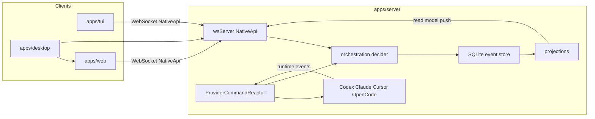

# t0code — code, architecture, and testing

t0code is a **local full-stack client for coding agents**. One Node/Bun server owns persistence, provider sessions, git, and terminals. Three shells talk to that server: the React web app, the OpenTUI terminal UI, and an Electron wrapper around the web app.

This document is the map of the repo: what each package does, how a prompt becomes a turn, and what to test when you change something.

## What the code does

A user picks a project (a git working tree), opens a thread, and sends a prompt. The server:

1. Records the command as domain events in SQLite.
2. Starts or resumes a provider session (Codex first; also Claude, Cursor, OpenCode).
3. Streams tool calls, diffs, approvals, and assistant text back to the UI.
4. Keeps git/worktree/checkpoint state so a thread can be inspected or reverted.

Clients do **not** talk to providers directly. They call a typed `NativeApi` over WebSocket. The server is the only process that shells out to Codex / ACP / git / PTYs.

## Repository map

This is a Bun workspaces + Turbo monorepo. Internal npm names still say `@t3tools/*` and the server package is `t3`. That is leftover from the T3 Code / t1code lineage. User-facing name is **t0code**.

| Path                                                                   | Package                   | Role                                                                                                  |
| ---------------------------------------------------------------------- | ------------------------- | ----------------------------------------------------------------------------------------------------- |
| [`apps/server`](apps/server)                                           | `t3`                      | WebSocket/HTTP server, orchestration, providers, git, PTY, SQLite                                     |
| [`apps/web`](apps/web)                                                 | `@t3tools/web`            | React 19 + Vite UI (chat, composer, diffs, settings)                                                  |
| [`apps/tui`](apps/tui)                                                 | `@maria_rcks/t1code`      | OpenTUI + React terminal UI (primary product surface)                                                 |
| [`apps/desktop`](apps/desktop)                                         | `@t3tools/desktop`        | Electron shell that hosts the web UI and a bundled server                                             |
| [`apps/marketing`](apps/marketing)                                     | `@t3tools/marketing`      | Astro landing / download pages                                                                        |
| [`packages/contracts`](packages/contracts)                             | `@t3tools/contracts`      | Effect Schema types only — WS protocol, commands, events, models. **No runtime logic.**               |
| [`packages/shared`](packages/shared)                                   | `@t3tools/shared`         | Shared runtime helpers (git, model slugs, shell, net). Subpath exports, no barrel.                    |
| [`packages/client-core`](packages/client-core)                         | `@t3tools/client-core`    | Shared **client** logic used by web and TUI (session helpers, mentions, keybindings, follow-up queue) |
| [`packages/effect-codex-app-server`](packages/effect-codex-app-server) | `effect-codex-app-server` | Generated Codex app-server JSON-RPC client                                                            |
| [`packages/effect-acp`](packages/effect-acp)                           | `effect-acp`              | Agent Client Protocol bindings (Cursor / other ACP agents)                                            |
| [`scripts`](scripts)                                                   | `@t3tools/scripts`        | Dev runner, TUI launcher, desktop/release scripts                                                     |

## Architecture



### Command → event → read model

Orchestration is event-sourced.

1. A client dispatches an `OrchestrationCommand` (for example `thread.turn.start`) through `NativeApi`.
2. [`apps/server/src/wsServer.ts`](apps/server/src/wsServer.ts) validates the request against `@t3tools/contracts`.
3. [`apps/server/src/orchestration/decider.ts`](apps/server/src/orchestration/decider.ts) checks invariants (thread exists, not archived, …) and emits events.
4. Events are appended in SQLite (`apps/server/src/persistence`).
5. [`apps/server/src/orchestration/projector.ts`](apps/server/src/orchestration/projector.ts) folds events into an `OrchestrationReadModel` (projects, threads, messages, sessions, plans).
6. The server pushes `orchestration.domainEvent` on the WebSocket. Web and TUI apply that into local state (`apps/web/src/store.ts`, TUI snapshot in `apps/tui/src/ui.tsx`).

Never invent a second source of truth in the client. If the UI disagrees with the server after a reconnect, the read model wins.

### Provider runtime

[`ProviderCommandReactor`](apps/server/src/orchestration/Layers/ProviderCommandReactor.ts) watches turn-start events and talks to the provider layer.

- **Codex:** `codex app-server` over JSON-RPC/stdio. Lifecycle lives in [`CodexSessionRuntime.ts`](apps/server/src/provider/Layers/CodexSessionRuntime.ts). Protocol types come from `effect-codex-app-server`.
- **Claude / Cursor / OpenCode:** drivers + adapters under `apps/server/src/provider/`. Cursor uses ACP (`effect-acp`).
- Provider stdout/events are ingested, turned into orchestration events, then projected like any other command.

The server also owns git (GitHub / GitLab / Azure DevOps / Bitbucket CLIs), worktrees, checkpoints, and `node-pty` terminals. Those APIs are also on `NativeApi`, not separate HTTP routes.

### Clients

**Web** (`apps/web`)

- Entry: `src/main.tsx` → TanStack Router in `src/routes/`.
- `readNativeApi()` in `src/nativeApi.ts` uses Electron `window.nativeApi` when present, otherwise a WebSocket client (`src/wsNativeApi.ts`).
- Chat/composer live in `src/components/ChatView.tsx`. Follow-up prompts while a turn is running go through `followUpQueue` in client-core, then send when the turn ends.

**TUI** (`apps/tui`)

- Entry: `src/index.tsx` → `src/ui.tsx` (large single UI module plus extracted helpers).
- Dev attach: `bun dev:tui` starts the server in `tui` mode, then the TUI with `T1CODE_HOST` / `T1CODE_PORT` / `T1CODE_AUTH_TOKEN`.
- Same NativeApi contract as web. Shared parsing/matching belongs in `packages/client-core`, not copied between `apps/tui` and `apps/web`.

**Desktop** (`apps/desktop`)

- Electron main process boots or attaches to the server and loads the web renderer.
- Product name is t0code. Legacy user-data directories may still be named `T3 Code (Alpha)` so existing installs keep their data.

### Persistence and env

- SQLite + migrations under `apps/server/src/persistence/Migrations/`.
- Default data dir: `T3CODE_HOME` (usually `~/.t3`). TUI prefs may also use XDG `t1code` paths.
- Remote/bind/auth: see [REMOTE.md](./REMOTE.md). Always set `T3CODE_AUTH_TOKEN` if the server is not localhost-only.

### Shared packages — do not leak logic

- **contracts:** schemas and types only. If you need a function, it does not belong here.
- **shared:** server-safe runtime utils, imported as `@t3tools/shared/git` (subpaths).
- **client-core:** UI-agnostic helpers (slash commands, mentions, keybinding match, title truncate, follow-up queue). If web and TUI both need it, put it here first.

## How a prompt travels (happy path)

1. User hits send in web or TUI.
2. If a turn is already running, the client **queues** the text (`packages/client-core/src/followUpQueue.ts`) and does not start a second turn.
3. Otherwise the client calls `orchestration.dispatchCommand({ type: "thread.turn.start", ... })`.
4. Decider writes `thread.message-sent` + turn-start events.
5. Projector updates the thread; UIs show the user message (plus an optimistic row until the event arrives).
6. ProviderCommandReactor starts `sendTurn` on the active provider.
7. Tool activity, approvals, and assistant tokens stream in as events.
8. When the turn completes, the client drains the next queued follow-up.

If you change any step, test both the idle-send path and the “send while running” queue path.

## How to run

```bash
bun install

bun dev          # server + web  (ports 3773 / 5733)
bun dev:tui      # server + terminal UI
bun dev:desktop  # Electron + web
bun dev:server   # server only
```

You need a provider CLI for real turns (Codex by default).

Quality gates used by this repo (from [AGENTS.md](./AGENTS.md)):

```bash
bun fmt
bun lint
bun typecheck
bun run test          # NOT `bun test` — that is a different Bun command
```

## How and what to test

Tests are **Vitest**, colocated as `*.test.ts` / `*.test.tsx` next to the code. Turbo runs `test` in each package after building dependencies (`turbo.json`: `test` depends on `^build`).

Always use **`bun run test`**. `bun test` is Bun’s built-in runner and is the wrong tool here.

### Commands

| What you want                   | Command                                                                   |
| ------------------------------- | ------------------------------------------------------------------------- |
| Whole monorepo                  | `bun run test`                                                            |
| One package                     | `bun run test --filter=@t3tools/web`                                      |
| One file                        | `bun run test --filter=@t3tools/client-core -- src/followUpQueue.test.ts` |
| Server (includes heavier cases) | `bun run test --filter=t3`                                                |
| Web browser tests               | `bun run --cwd apps/web test:browser` (Playwright Chromium)               |
| Desktop smoke                   | `bun run test:desktop-smoke`                                              |

Useful filters: `@t3tools/web`, `@t3tools/client-core`, `@t3tools/contracts`, `@t3tools/shared`, `@maria_rcks/t1code` (TUI), `t3` (server), `effect-acp`, `effect-codex-app-server`.

### What each layer’s tests cover

**contracts** — schema encode/decode for WS messages, providers, orchestration. Change a protocol field → run `@t3tools/contracts` tests and anything that imports that schema.

**shared** — model slug resolution, shell/path helpers, semver. Pure functions; cheap to run always.

**client-core** — slash commands, mentions, keybinding match, follow-up queue, session helpers. **This is the first place to test** if web and TUI should stay in sync.

**server (`t3`)**

- Unit tests next to layers (decider invariants, provider adapters, git CLIs, WS handlers).
- Integration tests in [`apps/server/integration/`](apps/server/integration): real orchestration engine + a test provider (`OrchestrationEngineHarness`). Use these when you change turn lifecycle, checkpoints, or projections.
- If you touch `decider.ts`, `projector.ts`, `ProviderCommandReactor.ts`, or persistence migrations, run the server package tests, not only a single unit file.

**web**

- Logic tests: `ChatView.logic.ts`, composer, stores, keybindings (Node Vitest).
- Browser tests: `*.browser.tsx` via `vitest.browser.config.ts` for real DOM (composer, pickers).
- Change scroll/queue/composer → `ChatView` + `ComposerPrimaryActions` + `followUpQueue` tests.

**TUI**

- Extracted helpers (`composerAction`, `composerMentions`, keybindings, git UI). `ui.tsx` itself is huge; prefer putting new behavior in a helper with a `*.test.ts`.
- Change send/stop/queue → `composerAction.test.ts` plus any new helper you add.

**desktop** — unit tests for update/arch/env; `smoke-test` for a real Electron launch.

**scripts** — `dev-runner` port/env behavior.

### What to test when you change X

| You changed                          | Minimum tests                                 | Also run                                          |
| ------------------------------------ | --------------------------------------------- | ------------------------------------------------- |
| A shared helper in client-core       | That file’s `*.test.ts`                       | Web + TUI packages if they call it                |
| Orchestration command or event shape | `packages/contracts`                          | Server decider + projector + one integration test |
| `decider.ts` / invariants            | `commandInvariants` + decider tests           | `apps/server/integration`                         |
| Provider adapter / Codex runtime     | That provider’s `*.test.ts`                   | `ProviderCommandReactor` tests                    |
| SQLite migration                     | Migration tests if present                    | Start server once against a fresh `T3CODE_HOME`   |
| Web composer / queue / scroll        | client-core `followUpQueue` + web logic tests | Browser test if you changed DOM                   |
| TUI composer actions                 | `composerAction.test.ts`                      | Manual `bun dev:tui` send + queue                 |
| NativeApi / WS method                | `contracts` `ws` tests + `wsServer.test.ts`   | Web `wsNativeApi` / `wsTransport` tests           |
| Git / worktrees                      | `apps/server/src/git` tests                   | Web `GitActionsControl.logic`                     |
| Only copy/branding                   | branding tests if they exist                  | `bun typecheck`                                   |

### Manual checks that unit tests will not catch

Do these after anything that touches turn lifecycle or reconnects:

1. `bun dev` — send a prompt, confirm the assistant streams, stop mid-turn, send again.
2. While a turn is running, type a second prompt and submit — it should **queue**, then send when the turn finishes.
3. Submit while scrolled up — timeline should jump to the bottom (web and TUI).
4. Restart the server and reopen the same thread — history and session resume.
5. Disconnect the WebSocket (kill server, restart) — UI should reconnect without duplicating messages.
6. `bun dev:tui` — same send / queue / stop paths in the terminal.

### Gates before you call a change done

From [AGENTS.md](./AGENTS.md):

1. `bun fmt`
2. `bun lint` (warnings may already exist; do not add new ones in your files)
3. `bun typecheck`
4. `bun run test` for the packages you touched (full `bun run test` before a release)

Prefer correctness over a green-but-wrong test. If a test mocks away the invariant you changed, replace the mock or add an integration case.

## Where to start reading

| If you want…               | Open this                                                |
| -------------------------- | -------------------------------------------------------- |
| Protocol and command types | `packages/contracts/src/orchestration.ts`, `ws.ts`       |
| “Is this command legal?”   | `apps/server/src/orchestration/decider.ts`               |
| How events become UI state | `apps/server/src/orchestration/projector.ts`             |
| How a turn hits Codex      | `apps/server/src/provider/Layers/CodexSessionRuntime.ts` |
| WS entrypoint              | `apps/server/src/wsServer.ts`                            |
| Web chat                   | `apps/web/src/components/ChatView.tsx`                   |
| TUI chat                   | `apps/tui/src/ui.tsx` + `composerAction.ts`              |
| Shared client helpers      | `packages/client-core/src/`                              |
| Remote / auth              | [REMOTE.md](./REMOTE.md)                                 |
| Keybindings                | [KEYBINDINGS.md](./KEYBINDINGS.md)                       |
