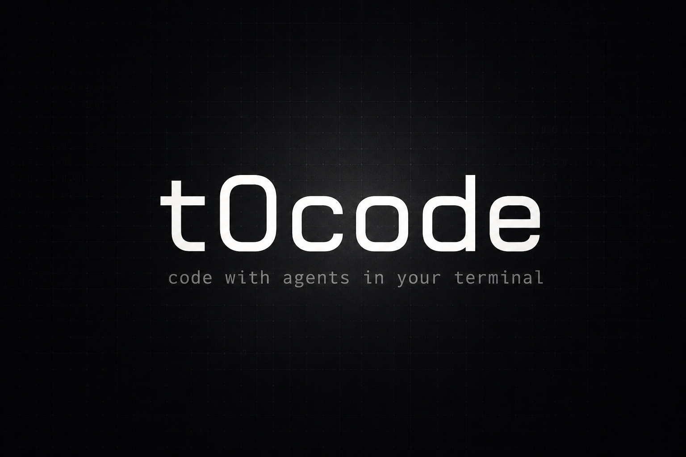

<div align="center">

# t0code

[](./LICENSE)
[](https://github.com/codealisha99/t0code)



_A local full-stack client for coding agents._

</div>

t0code is a Bun/TypeScript monorepo: a WebSocket server with SQLite persistence, a React web app, a terminal UI, and an optional Electron shell. Chat with Codex, Claude, Cursor, or OpenCode against a real repo, with git, diffs, terminals, and approvals in one place.

Maintained by [Alisha Karma](https://alishakarma.com) · [GitHub](https://github.com/codealisha99) · [Contact](mailto:lishykarma99@gmail.com)

## Requirements

- Bun `^1.3.9`
- Node `^24.13.1` (for some server/desktop tooling)
- A provider CLI such as Codex (`codex`) for the default agent

## Install

```bash
git clone https://github.com/codealisha99/t0code.git
cd t0code
bun install
```

## Run the stack

Web (server + browser UI):

```bash
bun dev
```

Terminal UI (server + TUI):

```bash
bun dev:tui
```

Desktop (Electron + web renderer):

```bash
bun dev:desktop
```

Marketing site:

```bash
bun dev:marketing
```

Server only:

```bash
bun dev:server
```

Default local ports are server `3773` and web `5733`. The web app talks to the server over WebSocket.

## Product notes

- While a turn is running, a new prompt is **queued** and sent when that turn finishes.
- Submitting a message **scrolls the timeline to the bottom**.
- Server data lives under `T3CODE_HOME` (default `~/.t3`). See [REMOTE.md](./REMOTE.md) for host, auth token, and remote access.

Architecture, package map, and what to test: [ARCHITECTURE.md](./ARCHITECTURE.md).

The cover image at [`assets/repo/t0code-cover.png`](./assets/repo/t0code-cover.png) is also the GitHub social preview. Upload the same file under Settings → Social preview if GitHub does not pick it up from the README.
