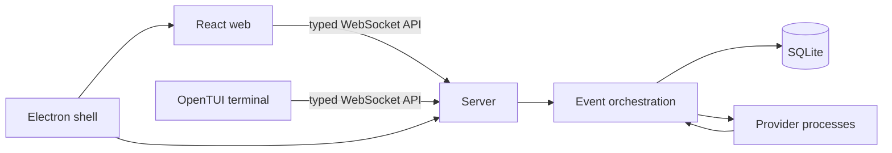

# Project guide

## What it does

t0code is a local workspace for using coding agents on a real repository. It brings agent conversations, streamed tool activity, approvals, Git changes, checkpoints, and terminal sessions into web and terminal interfaces. It addresses the friction of switching between an agent CLI and the repository tools needed to review its work.

The project is an early work in progress. The server, clients, local persistence, and provider adapters are implemented; provider availability depends on locally installed and authenticated CLIs. Some provider and source-control paths have incomplete coverage. In this checkout, 17 tests fail in the server package, and the existing default data directory fails startup on a missing SQLite column; see the [demo guide](DEMO_GUIDE.md) for verification details and workaround.

## Architecture

Clients send typed commands to the server. The server validates commands, records orchestration events in SQLite, projects them into current session state, and pushes updates back over WebSocket. Provider output returns through the same event flow. The server, rather than each client, owns persistence, provider processes, Git operations, and pseudo-terminals.

| Folder                                                    | Responsibility                                                       |
| --------------------------------------------------------- | -------------------------------------------------------------------- |
| `apps/server`                                             | HTTP/WebSocket API, orchestration, SQLite, providers, Git, terminals |
| `apps/web`                                                | React/Vite chat, settings, conversation and diff UI                  |
| `apps/tui`                                                | OpenTUI/React terminal interface                                     |
| `apps/desktop`                                            | Electron shell, bundled server lifecycle, updater                    |
| `apps/marketing`                                          | Astro home and download pages                                        |
| `packages/contracts`                                      | Shared schemas and protocol types                                    |
| `packages/client-core`                                    | Client logic shared by web and TUI                                   |
| `packages/shared`                                         | Runtime utilities shared across packages                             |
| `packages/effect-acp`, `packages/effect-codex-app-server` | ACP and Codex app-server protocol clients                            |
| `scripts`                                                 | Development runner and build/release utilities                       |

Main technologies: Bun workspaces and Turborepo; TypeScript with Effect; Node.js server APIs; SQLite; React 19, Vite, TanStack Router, OpenTUI, Electron, and Astro.

## Main workflow

1. Select or add a local project folder and create a conversation.
2. Choose an available agent provider and send a prompt.
3. The server starts or resumes that provider's process and records user, assistant, tool, approval, and diff events.
4. Clients render pushed state; follow-up prompts sent during an active turn queue until the turn finishes.
5. Inspect the resulting changes with Git, diff, checkpoint, and terminal tools.

Data defaults to `~/.t3`; override it with `T3CODE_HOME`. The TUI also stores its preferences and state in XDG-style `t1code` locations. No hosted application database is used.
